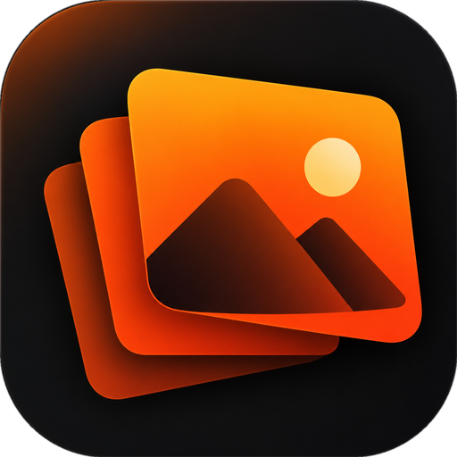
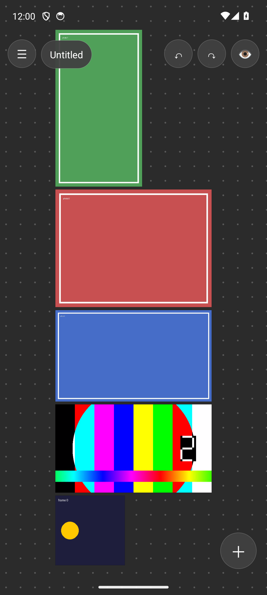
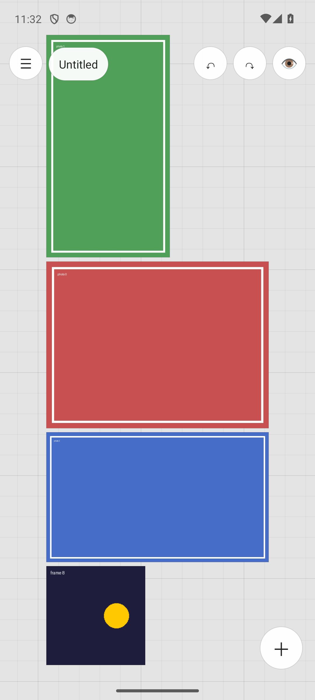
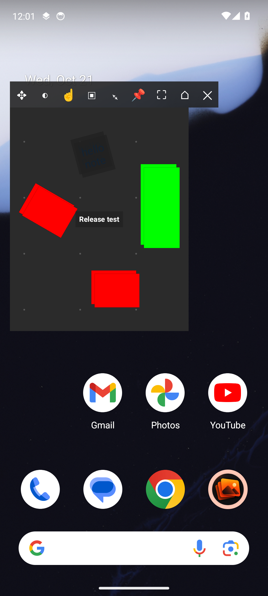
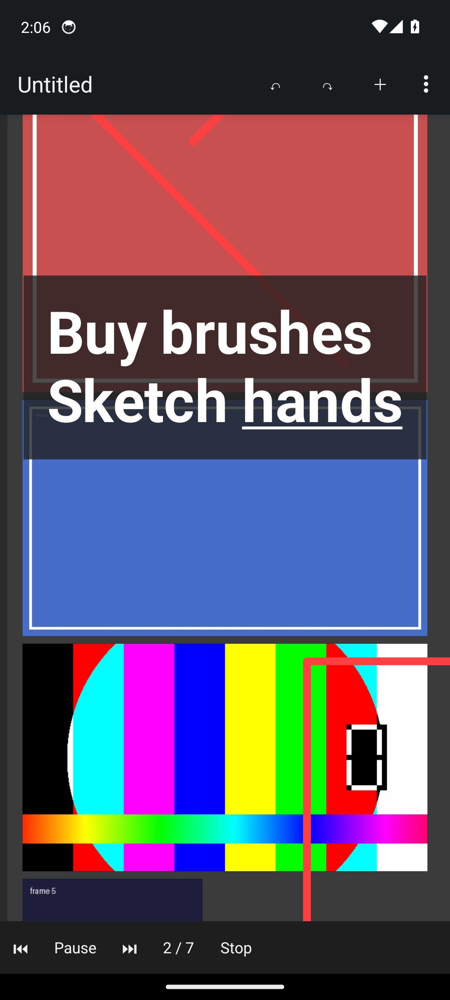

<div align="center">



# DroRef

**A free reference board for artists on Android — opens and saves PureRef .pur files.**

  

[](https://github.com/Iurika-N-T-R/DroRef/releases/latest)
[](https://github.com/Iurika-N-T-R/DroRef/releases)
[](LICENSE)
[](https://github.com/Iurika-N-T-R/DroRef/stargazers)

[**⬇️ Download**](#download) · [**📸 Screenshots**](#screenshots) · [**✨ Features**](#features) · [**🛠️ Build**](#build)

</div>

---

<a id="screenshots"></a>

## 📸 Screenshots

<div align="center">
<table>
  <tr>
    <td align="center"><br><sub><b>Board</b></sub></td>
    <td align="center"><br><sub><b>Light theme</b></sub></td>
    <td align="center"><br><sub><b>Floating over another app</b></sub></td>
    <td align="center"><br><sub><b>Slideshow</b></sub></td>
  </tr>
</table>
</div>

---

## 💡 What is DroRef?

DroRef helps **artists** gather their **reference images on one infinite board** on a phone or tablet,
without a PC and without losing the boards they already made in [PureRef](https://www.pureref.com).
It is free, open source, works offline and contains no ads or trackers.

Boards move between the two apps as `.pur` files: *File → Open .pur*, *Save*, *Save as .pur*
(from PureRef 2, save with *Save as → Legacy PureRef scene* first).

> DroRef is an independent app written from scratch and is not affiliated with PureRef or Idyllic Pixel.
> **On PC, use the original: https://www.pureref.com** · 🌐 Website: https://iurika-n-t-r.github.io/DroRef/

### 👥 Who is it for?

- 🎨 **Illustrators & painters** who keep moodboards and references next to their drawing app
- 🖥️ **PureRef users** who want their `.pur` boards on Android
- ⌨️ **Tablet + keyboard / Chromebook users** — same shortcuts and mouse controls as PureRef

---

<a id="features"></a>

## ✨ Features

| | Feature | Description |
|:-:|---|---|
| 🖼️ | **Infinite board** | Images, videos, GIFs, notes, drawings — pan, zoom, rotate, scale, group |
| 📂 | **PureRef compatible** | Open and save `.pur` files |
| 🪟 | **Always on top** | Float the board over your drawing app, with opacity and click-through for tracing |
| 🎨 | **Reference simplifier** | Squint at any image: flat shapes and value bands, color kept, your own presets |
| 🔗 | **Nodes & connections** | Link items with curved arrows that follow them |
| 📥 | **Drag & drop** | From the gallery, browser or files in split screen — and back out |
| ⌨️ | **Keyboard & mouse** | PureRef's shortcuts, command palette, in-app guide (Ctrl+H) |
| 🗂️ | **My scenes** | Every board as a preview, in folders |
| 🔒 | **Private by design** | No account, no tracking, everything stays on the device |

<details>
<summary><b>📖 Full guide — gestures, tools, keyboard & mouse</b></summary>

- The canvas fills the screen (dot background by default; grid or plain in the menu, under View; a center cross and a frame around the content too). Round buttons: menu and scene name top-left, undo, redo and focus mode top-right, add bottom-right (a short list: images, paste, note, node, draw).
- A rail of tools bottom-left: **select**, **hand** (drags and pinches only move the view, nothing moves by accident), **connect**, **draw**, and **lock**: images / videos / drawings, or notes / nodes / connections, can be locked so only the other layer is editable.
- The menu is a panel of icon tiles grouped by purpose (Add, Board, File, View); search, settings and about sit in its header.
- **Add** images and videos from the gallery, paste them, paste a link, use *Share → DroRef*, or **drag and drop** them from another app (gallery, browser, files) in split screen: they land where you drop them.
- To drag an image **out** to another app, select it, then long-press it again and drag.
- Drag empty space to pan, pinch to zoom, double-tap to focus.
- Tap to select. Drag to move; pinch or twist with two fingers to scale and rotate.
- Long-press an item to add it to the selection. Long-press empty space and drag to select a rectangle; release without dragging for the canvas panel.
- What's selected gets corner handles (drag to scale from the opposite corner), a rotate handle on the right (sticks at 45°), its size on the board underneath, and a short toolbar floating just above it (long-press an icon to see its name): info, rotate (90° / 180° / 270° / reset), size (100 % / ×2 / ×½), more and delete. "More" lists everything else in one scrolling list, by section: Transform, Arrange, Align, Normalize, Layers & groups, Item (duplicate, color label, web link, copy, cut, export…).
- **Simplify** (the palette button top-right, or *Alt+Q*) turns the whole canvas into its big shapes so you can block in first, then add detail: *Detail* blurs (like squinting), *Flat shapes* merges textures into flat masses, *Values* groups lights and darks into a few bands, and colors stay. Its panel floats over the board, so every change shows live; long-press the button to show or hide the panel. Save your settings as presets (tap to apply, long-press to delete).
- **Nodes and connections**: with *connect*, drag from one item to another to link them with a curved arrow that follows both; let go on empty space to create a new node there. Tap a connection to reverse it, put arrows at both ends, recolor or delete it. *Save as .pur* turns connections into drawings, since PureRef has none.
- **My scenes** (tap the scene name, or *Ctrl+Alt+L*) shows every scene as a preview; long-press one to rename it or move it into a folder. *Ctrl+Shift+L* jumps back to the previous scene.
- *Always on top* floats the board over your drawing app. Its bar has opacity, transparent-to-touch (for tracing), background off (only the images float), and a pin to show it only over one app (Android asks once for usage access).

Everything PureRef has, and what's done here: [FEATURES.md](FEATURES.md)

#### ⌨️ Keyboard and mouse
With a tablet keyboard cover, a Bluetooth keyboard and mouse, or a Chromebook, DroRef works like PureRef on a PC: same default shortcuts, same mouse controls. **Ctrl+H** (or the keyboard button in the menu) opens a short guide in the app; **Meta+/** lists every shortcut. The first time a keyboard is connected, DroRef points to the guide.

| Mouse | |
|:--|:--|
| Left-drag on empty space | Select (Shift adds to the selection) |
| Left-click / drag an item | Select / move it (Shift-click adds, Shift-drag moves in a straight line) |
| Ctrl-drag | Rotate (Ctrl+Shift: 45° steps) |
| Ctrl+Alt-drag | Scale |
| Middle-, right- or Alt-drag | Pan |
| Right-click | Menu for the item, or the canvas |
| Wheel | Zoom |
| Touchpad | Two-finger swipe pans, pinch zooms, Ctrl + swipe zooms |

| Keys | |
|:--|:--|
| Ctrl+Z / Ctrl+Shift+Z | Undo / redo |
| Ctrl+C / X / V, Ctrl+D, Del | Copy / cut / paste, duplicate, delete |
| Ctrl+I, Ctrl+N, Ctrl+Shift+D | Add images, note, draw |
| Space, Ctrl+Space, ← → | Focus selection, focus canvas, previous / next |
| Ctrl+P, Ctrl+Alt+N / A / O / D / R | Arrange optimal, by name / addition / order / path / randomly |
| Ctrl+arrows, Ctrl+Alt+arrows | Align, normalize |
| Alt+Shift+H / V, Ctrl+Shift+T | Flip, reset transform |
| Ctrl+G / Ctrl+Shift+G, P, ↑ ↓ | Group / ungroup, parent, front / back |
| Ctrl+K, Ctrl+Alt+L, Ctrl+Shift+L | New scene, my scenes, previous scene |
| Ctrl+S / Ctrl+Shift+S, Ctrl+L | Save / save as .pur, open .pur |
| Ctrl+Shift+P | Command palette |

</details>

---

<a id="download"></a>

## ⬇️ Download

<div align="center">

<a href="https://github.com/Iurika-N-T-R/iurikaFlows/releases/latest">
  
</a>
&nbsp;
<a href="https://github.com/Iurika-N-T-R/DroRef/releases/latest">
  
</a>

</div>

### 🟢 Recommended: with iurikaFlows (automatic updates)

1. Install **iurikaFlows** → [download here](https://github.com/Iurika-N-T-R/iurikaFlows/releases/latest).
2. Open it and find **DroRef** in *Découvrir*.
3. Tap **Install**. Future updates arrive automatically. ✅

### 🔵 Manual install (APK)

1. Go to the [**latest release**](https://github.com/Iurika-N-T-R/DroRef/releases/latest).
2. Under **Assets**, download the file ending in **`.apk`**.
3. Open it on your phone. If Android asks, allow **"Install unknown apps"** for your browser/file manager.
4. Tap **Install**. Done! 🎉

Also ready for F-Droid: the store listing lives in `fastlane/metadata/android/`.

<details>
<summary><b>❓ Why isn't it on the Play Store?</b></summary>
<br>
DroRef is an independent, free project. Instead of the Play Store, it is distributed through
GitHub Releases and <b>iurikaFlows</b>, a small open-source store that keeps all my apps up to date.
The APKs are built from this public source code — you can check everything.
</details>

<details>
<summary><b>🛡️ Is it safe? Android says "unknown source"</b></summary>
<br>
This warning appears for every app installed outside the Play Store. The code is 100% public in this repository,
and each release is signed with the same key, so Android will refuse any modified version.
</details>

> **Requirements:** Android 8.0+ · ~0.5 MB

---

<a id="build"></a>

## 🛠️ Build from source

<details>
<summary><b>For developers — click to expand</b></summary>

**Prerequisites:** [Android Studio](https://developer.android.com/studio) (latest) or the Android SDK (platform 36) · JDK 17–21

```bash
git clone https://github.com/Iurika-N-T-R/DroRef.git
cd DroRef
./gradlew assembleDebug
```

The APK is generated in `app/build/outputs/apk/debug/`.

**Signed release:** `./gradlew assembleRelease` signs the APK only if a git-ignored `keystore.properties`
(`storeFile`, `storePassword`, `keyAlias`, `keyPassword`) sits at the project root; otherwise it comes out unsigned.

Test the `.pur` reader and writer:

```bash
./gradlew testDebugUnitTest -PpurDir=/tmp/pur
```

That writes `kt_edit.pur` into the folder. Check it with real PureRef:
`PureRef -c 'load;/tmp/pur/kt_edit.pur' -c 'exportScene;/tmp/pur/out.png' -c exit`

- `./gradlew bundleRelease` → signed AAB in `app/build/outputs/bundle/release/`. Unsigned builds are what F-Droid expects (it signs with its own key).
- Launcher icon: `art/icon.png` → `python3 -I tools/icon.py` regenerates every size.
- Translations: one table, `tools/strings.py` → `python3 tools/strings.py` regenerates every `strings.xml`.
- `tools/ui.py` drives an emulator for quick UI checks (tap by label, screenshot).
- Everything PureRef has, and what's done here: [FEATURES.md](FEATURES.md)

**Project structure**

```
DroRef/
├── app/            # Android application
├── art/            # source of the launcher icon
├── docs/           # website (GitHub Pages) + screenshots
├── fastlane/       # F-Droid store listing
├── third_party/    # licenses of bundled assets
└── tools/          # icon, strings and UI-test scripts
```

</details>

---

## 🤝 Contributing

Ideas, bugs, translations — all contributions are welcome!

- 🐛 **Found a bug?** → [Open an issue](https://github.com/Iurika-N-T-R/DroRef/issues/new)
- 💡 **Have an idea?** → [Open an issue](https://github.com/Iurika-N-T-R/DroRef/issues) and describe it
- ⭐ **Like it?** → A star on this repo helps other people find it!
- ☕ **Want to support the work?** → [Buy me a coffee](https://buymeacoffee.com/iurika)

---

## 🧩 More apps by Iurika-N-T-R

<!-- Same block in EVERY repo: cross-linking boosts visibility of all the projects -->
| App | Description |
|---|---|
| [**iurikaFlows**](https://github.com/Iurika-N-T-R/iurikaFlows) | My open-source app store — installs and updates all my apps |
| [**OnlyFlows**](https://github.com/Iurika-N-T-R/OnlyFlows) | Offline-first task & project manager with LAN sync |
| [**ColorFlows**](https://github.com/Iurika-N-T-R/ColorFlows) | Color harmonies, palettes from pictures, painter's shading sphere |
| [**galleryFlows**](https://github.com/Iurika-N-T-R/galleryFlows) | Gallery that browses your real folder tree |
| [**vidéoFlows**](https://github.com/Iurika-N-T-R/videoFlows) | Your own videos in a vertical swipe feed |
| [**RandomFlows**](https://github.com/Iurika-N-T-R/RandomFlows) | Randomizer & decision maker on your own lists |
| [**Brush Converter**](https://github.com/Iurika-N-T-R/ABR-to-PRZP-Brush-converter) | Photoshop `.abr` brushes → Infinite Painter `.przp`, in the browser |

---

### 🙏 Credits

- `.pur` format: ported from [FyorDev/PureRef-format](https://github.com/FyorDev/PureRef-format) (MIT)
- Video loops idea: [lettucegoblin/AnimRef](https://github.com/lettucegoblin/AnimRef) (MIT)
- Icons: [Lucide](https://lucide.dev) (ISC, see `third_party/LUCIDE_LICENSE.txt`); `tools/icons.py` converts them

---

<div align="center">

📄 Released under the **[MIT License](LICENSE)**

Made with ❤️ by [**Iurika-N-T-R**](https://github.com/Iurika-N-T-R)

<sub>If DroRef is useful to you, consider giving it a ⭐ — it really helps!</sub>

</div>
