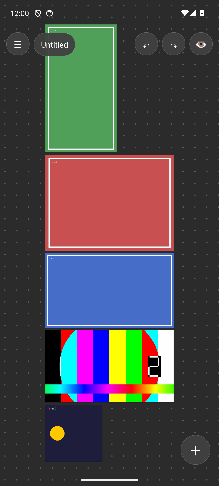
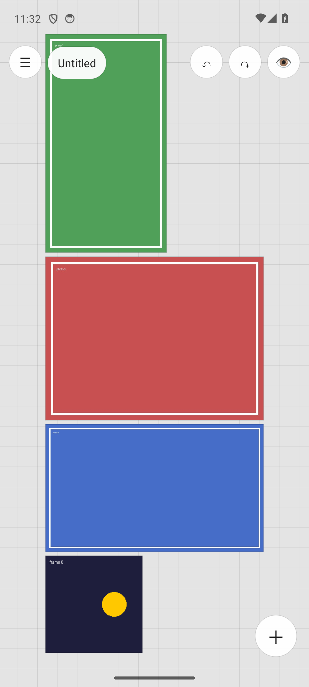
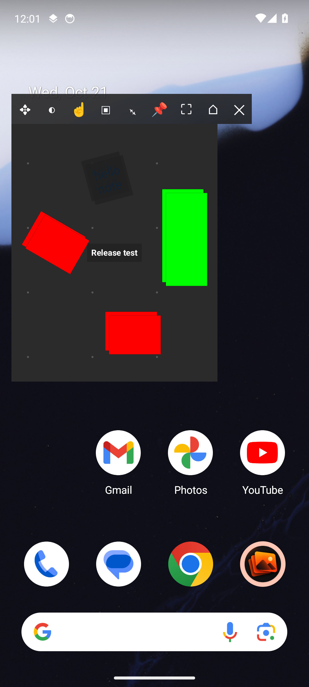

# DroRef

Free, open-source reference board for Android.

**Website:** https://iurika-n-t-r.github.io/DroRef/

  
  
  

Inspired by [PureRef](https://www.pureref.com). DroRef is an independent app written from scratch and is not affiliated with PureRef or Idyllic Pixel. **On PC, use the original: https://www.pureref.com**

Boards move between the two as `.pur` files: *File → Open .pur*, *Save*, *Save as .pur*.
From PureRef 2, save with *Save as → Legacy PureRef scene* first.

## Using it
- The canvas fills the screen (dot background by default; grid or plain in the menu, under View; a center cross and a frame around the content too). Round buttons: menu and scene name top-left, undo, redo and focus mode top-right, add bottom-right (a short list: images, paste, note, node, draw).
- A rail of tools bottom-left: **select**, **hand** (drags and pinches only move the view, nothing moves by accident), **connect**, **draw**, and **lock**: images / videos / drawings, or notes / nodes / connections, can be locked so only the other layer is editable.
- The menu is a panel of icon tiles grouped by purpose (Add, Board, File, View); search, settings and about sit in its header.
- **Add** images and videos from the gallery, paste them, paste a link, use *Share → DroRef*, or **drag and drop** them from another app (gallery, browser, files) in split screen: they land where you drop them.
- To drag an image **out** to another app, select it, then long-press it again and drag.
- Drag empty space to pan, pinch to zoom, double-tap to focus.
- Tap to select. Drag to move; pinch or twist with two fingers to scale and rotate.
- Long-press an item to add it to the selection. Long-press empty space and drag to select a rectangle; release without dragging for the canvas panel.
- What's selected gets corner handles (drag to scale from the opposite corner), a rotate handle on the right (sticks at 45°), its size on the board underneath, and a short toolbar floating just above it (long-press an icon to see its name): info, rotate (90° / 180° / 270° / reset), size (100 % / ×2 / ×½), more and delete. "More" lists everything else in one scrolling list, by section: Transform, Arrange, Align, Normalize, Layers & groups, Item (duplicate, color label, web link, copy, cut, export…).
- **Nodes and connections**: with *connect*, drag from one item to another to link them with a curved arrow that follows both; let go on empty space to create a new node there. Tap a connection to reverse it, put arrows at both ends, recolor or delete it. *Save as .pur* turns connections into drawings, since PureRef has none.
- **My scenes** (tap the scene name, or *Ctrl+Alt+L*) shows every scene as a preview; long-press one to rename it or move it into a folder. *Ctrl+Shift+L* jumps back to the previous scene.
- *Always on top* floats the board over your drawing app. Its bar has opacity, transparent-to-touch (for tracing), background off (only the images float), and a pin to show it only over one app (Android asks once for usage access).

Everything PureRef has, and what's done here: [FEATURES.md](FEATURES.md)

## Keyboard and mouse
With a tablet keyboard cover, a Bluetooth keyboard and mouse, or a Chromebook, DroRef works like PureRef on a PC: same default shortcuts, same mouse controls. **Ctrl+H** (or the keyboard button in the menu) opens a short guide in the app; **Meta+/** lists every shortcut. The first time a keyboard is connected, DroRef points to the guide.

| Mouse | |
|:--|:--|
| Left-drag on empty space | Select (Shift adds to the selection) |
| Left-click / drag an item | Select / move it (Shift-click adds, Shift-drag moves in a straight line) |
| Ctrl-drag | Rotate (Ctrl+Shift: 45° steps) |
| Ctrl+Alt-drag | Scale |
| Middle-, right- or Alt-drag | Pan |
| Right-click | Menu for the item, or the canvas |
| Wheel | Zoom |
| Touchpad | Two-finger swipe pans, pinch zooms, Ctrl + swipe zooms |

| Keys | |
|:--|:--|
| Ctrl+Z / Ctrl+Shift+Z | Undo / redo |
| Ctrl+C / X / V, Ctrl+D, Del | Copy / cut / paste, duplicate, delete |
| Ctrl+I, Ctrl+N, Ctrl+Shift+D | Add images, note, draw |
| Space, Ctrl+Space, ← → | Focus selection, focus canvas, previous / next |
| Ctrl+P, Ctrl+Alt+N / A / O / D / R | Arrange optimal, by name / addition / order / path / randomly |
| Ctrl+arrows, Ctrl+Alt+arrows | Align, normalize |
| Alt+Shift+H / V, Ctrl+Shift+T | Flip, reset transform |
| Ctrl+G / Ctrl+Shift+G, P, ↑ ↓ | Group / ungroup, parent, front / back |
| Ctrl+K, Ctrl+Alt+L, Ctrl+Shift+L | New scene, my scenes, previous scene |
| Ctrl+S / Ctrl+Shift+S, Ctrl+L | Save / save as .pur, open .pur |
| Ctrl+Shift+P | Command palette |

## Build
Open this folder in Android Studio and press Run, or from a terminal:

    ./gradlew assembleDebug

The APK lands in `app/build/outputs/apk/debug/`.

Test the `.pur` reader and writer:

    ./gradlew testDebugUnitTest -PpurDir=/tmp/pur

That writes `kt_edit.pur` into the folder. Check it with real PureRef: `PureRef -c 'load;/tmp/pur/kt_edit.pur' -c 'exportScene;/tmp/pur/out.png' -c exit`

The launcher icon comes from `art/icon.png`: run `python3 -I tools/icon.py` to regenerate every size.

Translations live in one table, `tools/strings.py`. Edit it and run `python3 tools/strings.py` to regenerate every `strings.xml`.
`tools/ui.py` drives an emulator for quick UI checks (tap by label, screenshot).

## Release
Download the APK from [Releases](../../releases), or build it:

    ./gradlew assembleRelease   # signed APK  -> app/build/outputs/apk/release/
    ./gradlew bundleRelease     # signed AAB for Google Play -> app/build/outputs/bundle/release/

Signing reads `keystore.properties` (git-ignored): `storeFile`, `storePassword`, `keyAlias`, `keyPassword`.
Without it, release builds are unsigned, which is what F-Droid expects (it signs with its own key).
Store listing text and screenshots for F-Droid live in `fastlane/metadata/android/`.

## Support
DroRef is built and maintained solo and stays free. If it helps you, consider [buying me a coffee](https://buymeacoffee.com/iurika) ☕

## Credits
- `.pur` format: ported from [FyorDev/PureRef-format](https://github.com/FyorDev/PureRef-format) (MIT)
- Video loops idea: [lettucegoblin/AnimRef](https://github.com/lettucegoblin/AnimRef) (MIT)
- Icons: [Lucide](https://lucide.dev) (ISC, see `third_party/LUCIDE_LICENSE.txt`); `tools/icons.py` converts them

## License
MIT
